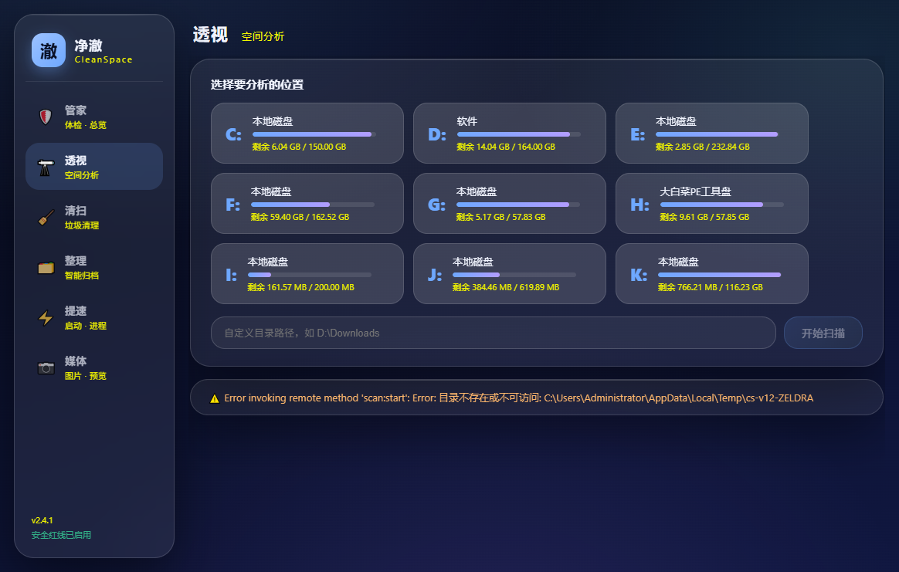
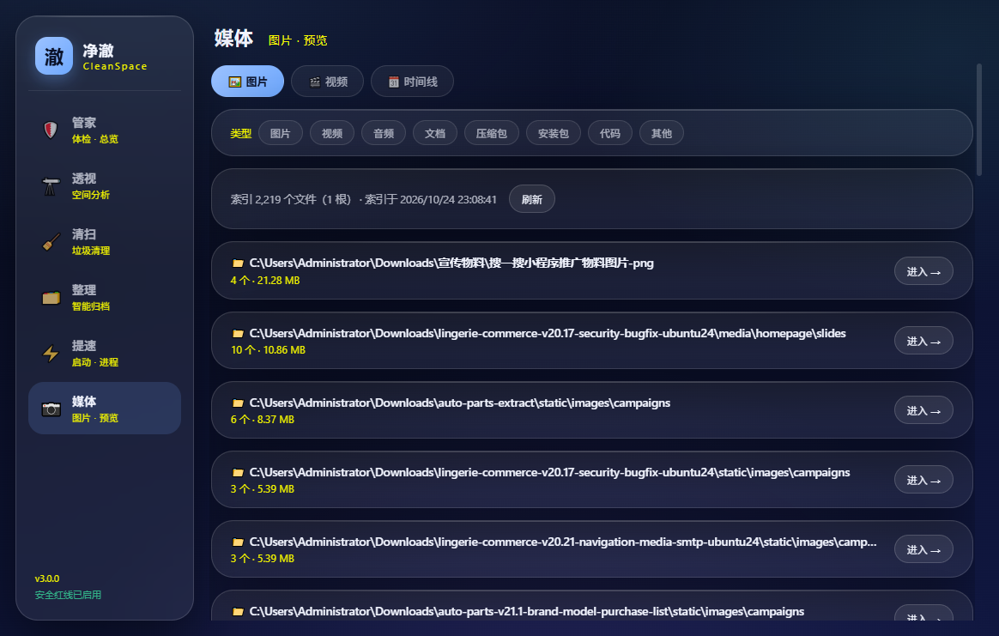

# 净澈 CleanSpace

<div align="center">


**看得见、删不错、能反悔的 Windows 空间清理与提速工具**

一次扫描，全盘空间尽收眼底；每一次删除都可恢复。从「看见」到「驾驭」再到「懂你」——净澈把磁盘清理做成了透明、安全、有记性的过程。

   

**[下载最新版](../../releases/latest)** · [功能总览](#功能总览) · [安全设计](#安全设计红线清单)

</div>

---

## 为什么做这个

市面清理工具的通病：**黑箱**（不知道它删了什么）、**激进**（误删后无法挽回）、**粗鲁**（C 盘满只能干瞪眼）。净澈的原则只有一条——

> **先看见 → 再决策 → 可撤销。**

所有分析只读，所有删除软删（进应用内回收站，可按批次恢复到原路径），所有不可逆操作强制二次确认。

## 功能总览

### 🌞 透视 · Insight
- **旭日图**全盘空间可视化，逐层下钻；TOP 50 大文件 / TOP 20 文件夹 / 类型分布
- **全局搜索**（扫描即建索引，10 万文件组合查询 < 10ms）
- **时光机**：扫描快照对比，空间增长趋势一目了然
- **大文件体检**（v3.0）：TOP 大文件逐个告诉你「这是什么、能不能删」——🟢🟡🔴❓ 四档结论，附判断依据
- **空间预警**：C 盘告急托盘图标变红 + Windows 通知

### 🧹 清扫 · Clean
- **三级确认**（规则 → 明细预览 → 输入确认）：删除前看清每一项
- 一键清理（系统临时/浏览器缓存/回收站等 10+ 规则，白名单硬排除）
- **相似图片清理**（pHash 感知哈希，缩略图对比挑选）
- **空文件夹清理** / **卸载残留**（注册表×磁盘双重校验，厂商字典零误判）
- **应用内回收站**：15 天保留，按批次恢复；**批次勾选批量永久删 + 一键清空 + Windows 系统回收站统计/一键清空**（v4.2.8）；操作日志可导出
- 全站**全选/反选/清空**工具条（v4.2.7）——清扫/聊天/空目录/残留/相似/重复六页统一

### 🗂️ 整理 · Organize
- **重复文件查重**（大小分组 → 头尾哈希 → 全量 SHA-256 三层校验）
- 整理预案（零写入预演）→ 执行 → **整批回滚**
- 目标目录智能推荐

### ⚡ 提速 · Speedup
- 启动项管理（备份式禁用，可随时恢复）
- 进程面板 + 系统概况

### 📷 媒体 · Media
- 全盘**图片/视频搜集**（目录聚合收藏点 + 缩略图墙）
- **灯箱预览**（缩放/翻页/路径复制/定位）+ **视频点播**（倍速/续播记忆/编码不支持自动调系统播放器）
- **相册时间线**（v3.0）：EXIF 拍摄时间排成手机相册式年月时间线，「那年今天」找回回忆
- 类型筛选 / 四键排序 / 右键菜单 / 网格列表切换

### 🏠 管家 · Dashboard
- **一键体检**（六维评分 + 逐项修复建议）
- 定期任务（扫描/体检/清理计划）
- **月度清理报告**（玻璃风单文件 HTML 战报，本地生成不上传）
- 设置中心 / 空间预警 / 检查更新

### 🧠 懂你（v3.0）
- **大文件体检**：TOP 大文件逐个告诉你「这是什么、能不能删」（🟢🟡🔴❓ 四档+判断依据）
- **相册时间线**：EXIF 拍摄时间排成手机相册式年月时间线，「那年今天」找回回忆

### 🤖 自治（v3.1）
- **微信/QQ 专清**：多账号分区清理（缓存🟢/聊天内容🟡默认不勾+按会话）——聊天记录数据库物理隔离
- **自动清理规则**：目录+模式+保留天数 → 每周体检软删除预案（绝不真删）
- **下载目录自动整理**：监视指定目录、三档模式（仅报告/自动+回滚/关）

### 🤿 深潜（v3.2）
- **C 盘深度专清**：WinSxS/还原点/休眠文件——只读分析+引导式清理，不可逆须文字确认
- **浏览器细分**：Chrome/Edge/Firefox 缓存安全清理——书签/密码/历史/扩展物理隔离

### 🏁 收官（v3.3）
- **视频查重**：时长+头/中/尾三帧哈希归组（同视频多分辨率现形）
- **命令面板**：Ctrl+K 全局唤起（导航/动作/搜索/小数据）

### 🌍 出海（v3.4）
- **中英双语**：设置一键切换即时生效
- **代码签名**：配置位就绪（采购证书后启用）

## 安全设计（红线清单）

这不是口号——**每条红线都有自动化测试守护**（230 项单元测试 + 全量打包自测）：

| # | 红线 | 落地 |
|---|------|------|
| 1 | 系统关键目录永不触碰 | 白名单硬排除，注入测试 |
| 4 | 一切删除可撤销 | 软删除回收站 + 批次恢复 |
| 8 | 卸载残留零误判 | 注册表 + 厂商字典双重校验 |
| 10 | 更新包校验 | SHA-512（electron-updater） |
| 14 | 大文件建议绝不代删 | 🔴/未知项物理不可勾选 |
| 20 | EXIF 只读 | 字节级不变测试 |

## 界面

visionOS 式**液态玻璃**设计语言：深色极光背景、悬浮玻璃卡片。

<details>
<summary>📸 界面截图（点击展开）</summary>

| 透视 · 旭日图 | 媒体 · 时间线 |
|---|---|
|  |  |

</details>

## 安装

从 [Releases](../../releases) 下载最新安装包（NSIS x64）或便携版 zip。

装好后**无需再下载安装包**——设置 → 检查更新，新版本自动下载（差分下载省流量），一键重启即完成升级。

- Windows 10/11 x64
- 无需安装运行时（Electron 自包含）
- 便携版解压即用

## 构建

```bash
npm install
npm test          # 230 项测试
npm run dist      # 构建三端 + 打包安装包
```

技术栈：Electron 45 + Vue 3 + TypeScript + better-sqlite3 + Vitest；扫描引擎 Worker 池并行 + SQLite 缓存（二次扫描秒回，深层陈旧自动检测重扫）。

## 版本史

| 版本 | 主题 | 亮点 |
|------|------|------|
| v1.x | 看见 | 五大模块、软删除回收站、三级确认 |
| v2.0 | 火眼金睛 | 相似图片 pHash、空文件夹 |
| v2.1 | 时光机 | 快照对比、空间预警（托盘变红） |
| v2.2 | 媒体中心 | 全局搜索、图片/视频搜集、灯箱点播 |
| v2.3 | 清道夫 | 卸载残留、月度报告 |
| v2.4 | 管家升级 | 自动更新（generic provider） |
| v3.0 | 懂你 | 大文件体检助手、相册时间线（EXIF） |
| v3.1 | 自治 | 微信/QQ 专清、自动清理规则、下载目录整理 |
| v3.2 | 深潜 | C 盘深度专清（UAC）、浏览器细分专清 |
| v3.3 | 收官 | 视频查重、Ctrl+K 命令面板 |
| v3.4 | 出海 | 中英双语 i18n、代码签名配置 |
| v4.0 | 基石 | 稳定性重构（IPC 响应式克隆、时间线修复） |
| v4.1 | 守护 | 崩溃恢复横幅 + 启动自检 |
| v4.2 | 顺滑 | 安全口袋、台账回退、扫描爆栈根治（百万文件 83s）、全选工具条、系统回收站、OTA 在线更新 |

## License

[MIT](LICENSE) © 2026 CleanSpace contributors

> 本软件按「现状」提供。清理有风险，删除需谨慎——但用了净澈，你可以反悔。
